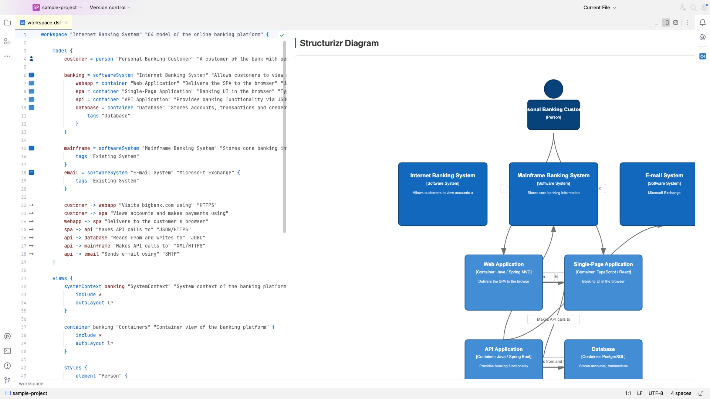
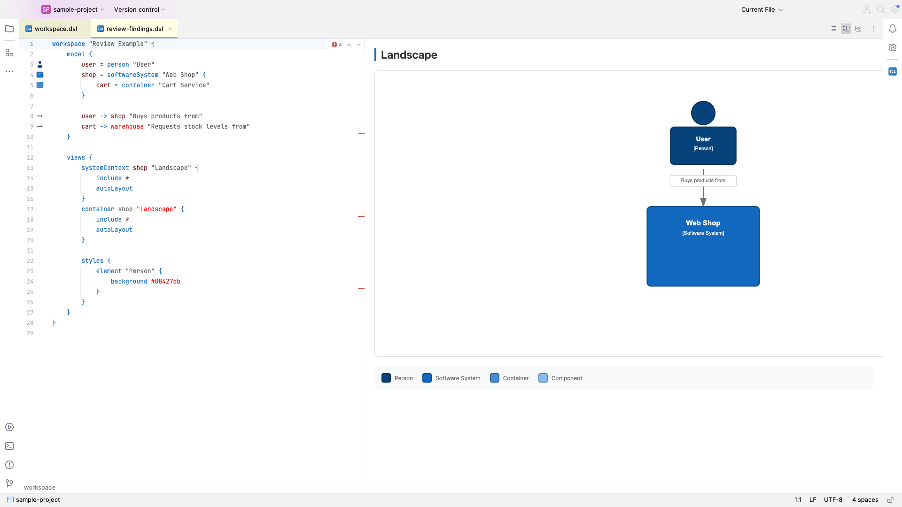
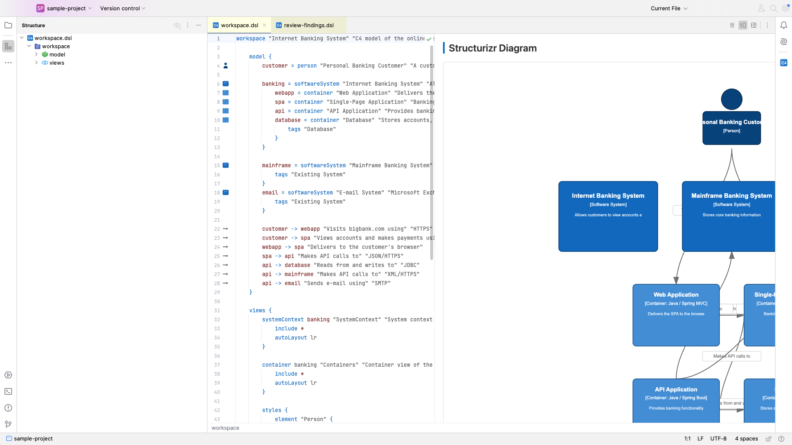
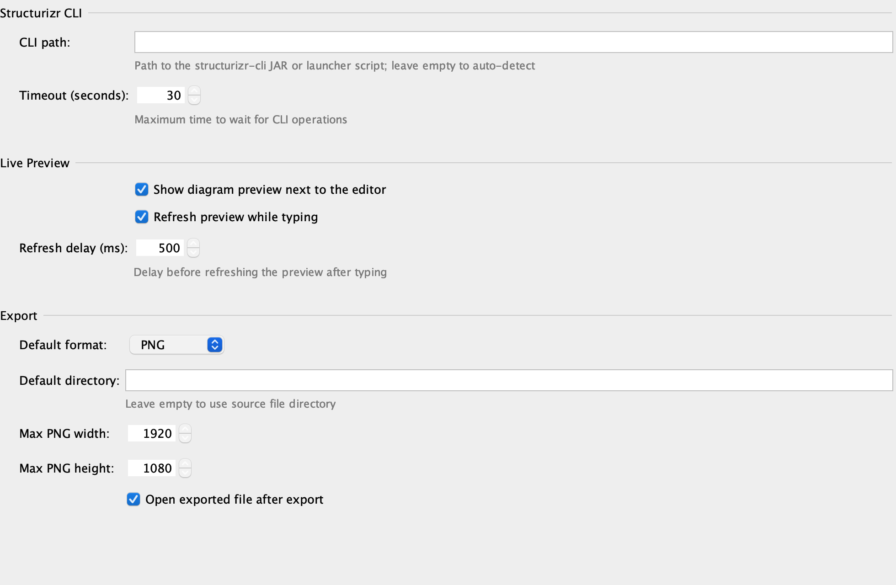

# Structurizr DSL Plugin for JetBrains IDEs

[](LICENSE)

[](https://plugins.jetbrains.com/plugin/29351-structurizr-dsl)
[](https://plugins.jetbrains.com/plugin/29351-structurizr-dsl)

Full language support for [Structurizr DSL](https://docs.structurizr.com/dsl/language) — a text-based language for defining software architecture models based on the [C4 model](https://c4model.com/) by Simon Brown.

## Screenshots

| Syntax highlighting & live preview | Code inspections |
|---|---|
|  |  |

| Structure view | Settings |
|---|---|
|  |  |

## Features

| Feature | Description |
|---------|-------------|
| **Syntax Highlighting** | Full highlighting for keywords, strings, comments, identifiers, directives, operators, colors, shapes |
| **Code Completion** | Context-aware keyword completion + identifier completion from defined elements |
| **Go to Definition** | Ctrl+Click / Ctrl+B to navigate to element definitions |
| **Find Usages** | Alt+F7 to find all references to an element |
| **Structure View** | Hierarchical tree: workspace → model → views → elements |
| **Breadcrumbs** | Navigation path showing current scope |
| **Code Folding** | Fold/unfold all block constructs |
| **Brace Matching** | Highlight matching `{ }` pairs |
| **Code Formatting** | Reformat code with Ctrl+Alt+L |
| **Comment/Uncomment** | Toggle comments with Ctrl+/ |
| **Line Markers** | Gutter icons for element definitions |
| **10 Inspections** | Undefined references, unused elements, duplicate IDs, duplicate view keys, empty blocks, missing properties, deprecated keywords, invalid colors, invalid contexts, invalid relationships |
| **Quick Fixes** | Create missing elements, remove unused, rename |
| **Color Preview** | Gutter swatches for hex colors in styles, with built-in color picker |
| **Smart Relationship Completion** | After `->`, suggests only defined elements (source excluded) |
| **Live Templates** | 21 templates: `ws`, `per`, `ss`, `con`, `comp`, `rel`, `dep`, `sv`, `cv`, `sty`, `grp`, `props`, `anim`, `autolay`, and more |
| **Documentation** | Ctrl+Q hover documentation for keywords |
| **${} Highlighting** | Variable substitution highlighting in strings |
| **Live Diagram Preview** | Real-time C4 diagram rendering in a tool window |
| **Split Editor** | Side-by-side DSL code and diagram view |
| **Export** | Export diagrams as SVG, PNG, PlantUML, Mermaid |
| **Copy to Clipboard** | Copy diagrams as SVG, image, PlantUML, or Mermaid |
| **CLI Integration** | Auto-download and manage Structurizr CLI |
| **Rename Refactoring** | Rename identifiers across all references |

## Supported Keywords

All Structurizr DSL keywords are supported including:

- **Model:** `workspace`, `model`, `person`, `softwareSystem`, `container`, `component`, `group`, `element`
- **Deployment:** `deploymentEnvironment`, `deploymentNode`, `deploymentGroup`, `infrastructureNode`, `softwareSystemInstance`, `containerInstance`
- **Views:** `systemLandscape`, `systemContext`, `container`, `component`, `filtered`, `dynamic`, `deployment`, `custom`, `image`
- **Styles:** `styles`, `element`, `relationship`, `theme`, `themes`, `terminology`
- **Directives:** `!include`, `!identifiers`, `!impliedRelationships`, `!const`, `!var`, `!docs`, `!adrs`, `!script`, `!plugin`, `!element`, `!elements`, `!relationship`, `!relationships`
- **Properties:** `tags`, `description`, `technology`, `url`, `properties`, `perspectives`

## Installation

1. Open **Settings** → **Plugins** → **Marketplace**
2. Search for "**Structurizr DSL**"
3. Click **Install** and restart the IDE

Or install from: [JetBrains Marketplace](https://plugins.jetbrains.com/plugin/29351-structurizr-dsl)

## Compatibility

- **IDE Versions:** 2024.3+ (all future versions supported)
- **JetBrains IDEs:** IntelliJ IDEA (CE + Ultimate), WebStorm, PhpStorm, PyCharm, GoLand, RubyMine, CLion, Rider, DataGrip, Android Studio, Writerside, Aqua, MPS, DataSpell, RustRover
- **OS:** Windows, macOS, Linux

## Quick Start

1. Create a file with `.dsl` extension
2. Type `ws` + Tab to insert a workspace template
3. Use `per`, `ss`, `con`, `comp` for element templates
4. Use Ctrl+Space for context-aware completion
5. Use Ctrl+Click to navigate to definitions

## Settings

- **Global:** Settings → Tools → Structurizr DSL
- **Project:** Settings → Tools → Structurizr DSL (Project)

Configure: CLI path, auto-preview, export format, diagram theme, auto-layout direction.

## Build from Source

```bash
./gradlew buildPlugin
# Output: build/distributions/structurizr-dsl-plugin-*.zip
```

## Test

```bash
./gradlew test
# 866 tests
```

## CI/CD

The project uses GitHub Actions for continuous integration:

- **CI** (`ci.yml`) — Runs build, test, and verifyPlugin on every push/PR to `main`
- **Release** (`release.yml`) — Builds, creates GitHub release, and publishes to JetBrains Marketplace on tag push

## License

Apache License 2.0 — see [LICENSE](LICENSE) and [NOTICE](NOTICE). Copyright 2026 Jakub Jirák.

## Links

- [Structurizr DSL Language Reference](https://docs.structurizr.com/dsl/language)
- [C4 Model](https://c4model.com/)
- [JetBrains Marketplace](https://plugins.jetbrains.com/plugin/29351-structurizr-dsl)
- [Issue Tracker](https://github.com/JirakJ/structurizr-dsl-plugin/issues)

## Free & open source

Since version 2026.8.0 the plugin is completely free — every feature is unlocked and no license is needed. The source code is open source under the [Apache License 2.0](LICENSE).

## Contributing

Issues and pull requests are welcome at https://github.com/JirakJ/structurizr-dsl-plugin.
